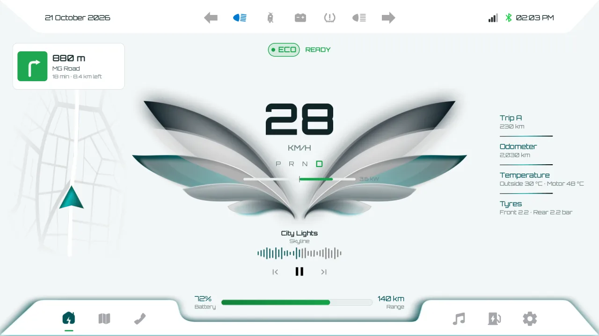
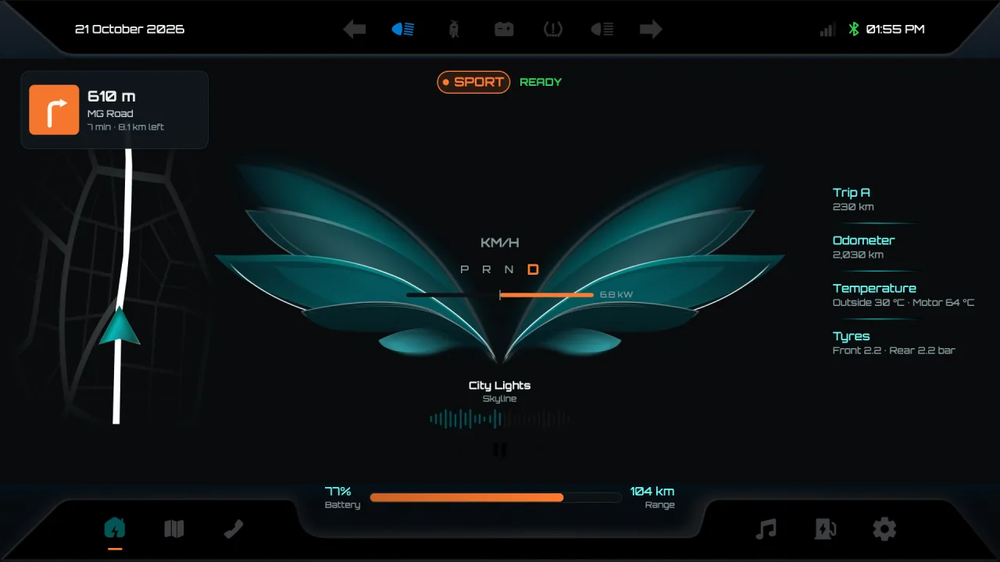
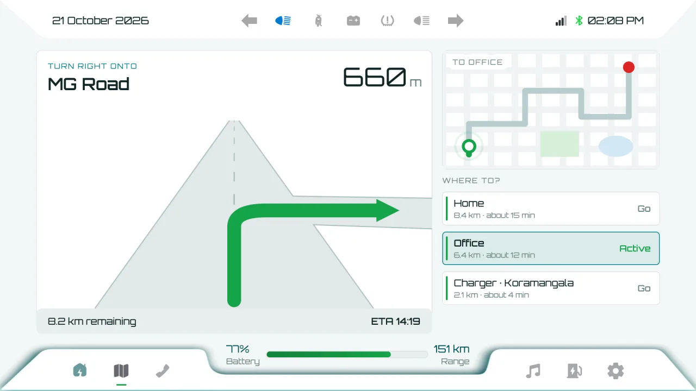
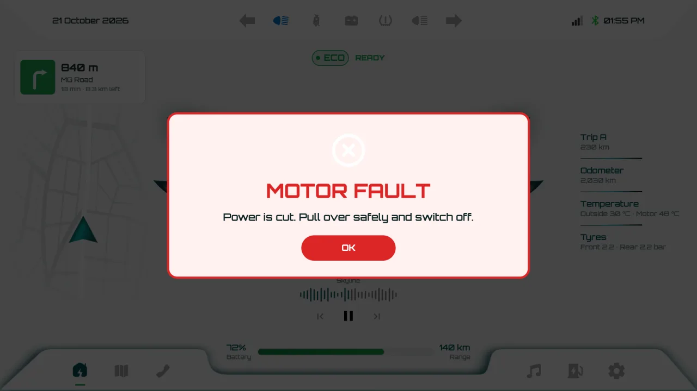
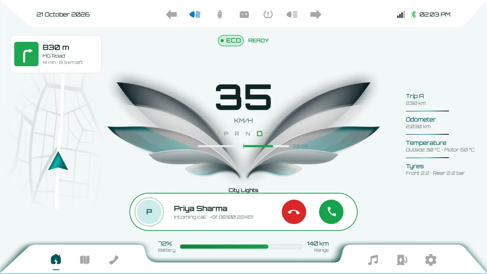
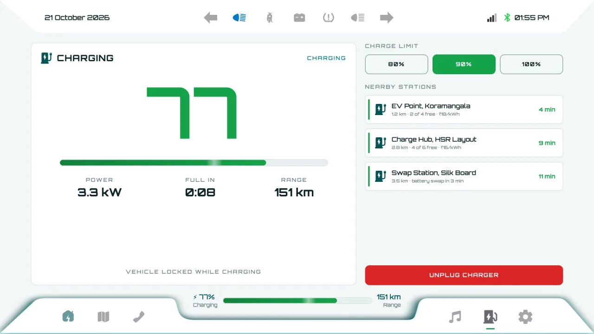
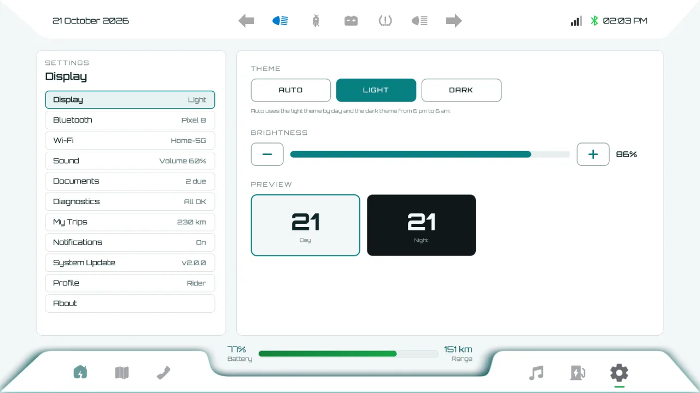

# Eagle Dashboard

An instrument cluster and infotainment HMI for an electric commuter scooter, in
Qt 6, QML and C++17. It runs on the desk as a full simulation and on a Rockchip
RK3328 board with a 7-inch touch panel, reading the scooter's CAN bus.



| | |
|---|---|
|  |  |
|  |  |
|  |  |

## What it does

- **Ride view:** speed, Eco / City / Sport modes (the whole UI takes the mode's
  colour), gear, power and regen, battery and range, the next turn and the
  phone's music.
- **Telltales** driven by the vehicle: indicators blinking together at 85 a
  minute, low and high beam, side stand, battery temperature, tyre pressure.
- **Alerts:** warnings slide in as a banner, critical faults (motor, battery,
  side stand while moving) take the screen. Every rule has hysteresis.
- **Phone:** incoming calls answered from any page, the call in progress with
  timer and mute, recent calls, favourites, a dial pad; media with
  play/pause/skip and volume.
- **Navigation:** the next manoeuvre drawn onto the road ahead, saved places and
  a route overview.
- **Charging:** live charge, power, time to full, charge limit and nearby
  stations.
- **Documents:** licence, Aadhaar and PAN cards, and the vehicle's papers with
  their expiry status.
- **Connectivity:** Bluetooth (pair, forget, scan) and Wi-Fi (scan, connect
  with password).
- **Diagnostics** with live readings and every active alert; key-on
  self-check; light, dark and automatic themes; brightness.

## Architecture

| Layer | |
|---|---|
| `dashboarddata` | The vehicle: one bounded value per signal, grouped by change |
| `vehiclesimulator` | A looping city ride with stops, indicators before turns and every fault |
| `canvehiclesource` | The same values from SocketCAN on the scooter ([docs/CAN.md](docs/CAN.md)) |
| `alertcenter` | Ranks alerts and decides what is on screen |
| `phoneservice` | Calls, media and contacts from the rider's phone |
| `bluetoothmanager`, `wifimanager` | BlueZ through Qt Bluetooth, NetworkManager through nmcli; simulated off the board |
| `vehicledocuments` | Papers and their expiry |
| QML | `StyleTheme` design tokens; `Component/` building blocks; `Pages/` screens |

The UI is laid out once on a 1920 × 1080 canvas and scaled to the panel.

## Build and run

```sh
mkdir -p build && cd build
qmake ../EagleTheme.pro && make -j8
./EagleTheme.app/Contents/MacOS/EagleTheme      # macOS; ./EagleTheme on Linux
```

Options: `--board` (full screen on the panel), `--can can0` (live data),
`--no-simulator`, `--snapshot <dir>` (saves every page and alert state as PNG).

Bench keys: **M** ride mode, **C** incoming call / answer, **X** message,
**P** charger, **T** theme, **H** high beam, **F** motor fault, **L** low tyre,
**O** overheat, **Z** hazard lights, **R** reverse (taken at the next stop), **Backspace** clear,
**1–6** pages.

Tests: `cd tests && qmake && make && ./tst_core` (CAN decoding, alert rules,
call flow, documents).

On the RK3328 board: [docs/RK3328.md](docs/RK3328.md).

## Credits

Orbitron typeface, SIL Open Font License (`fonts/Orbitron-OFL.txt`).
